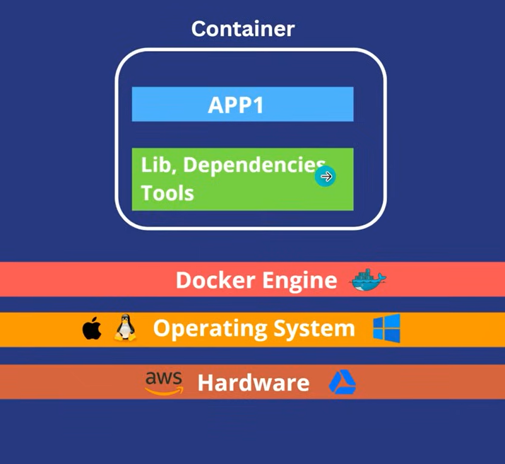
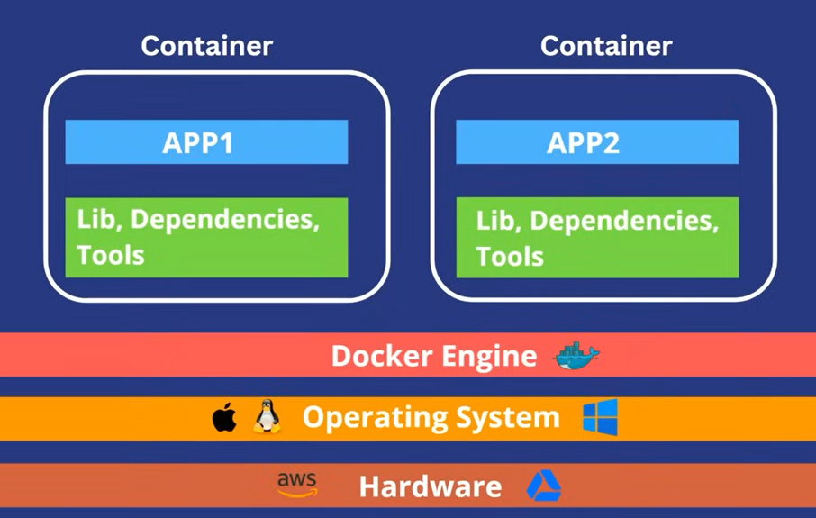
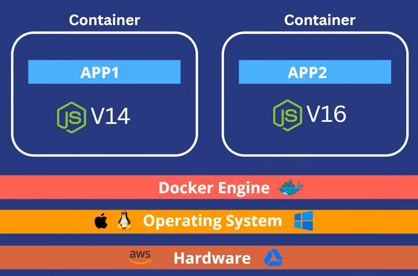
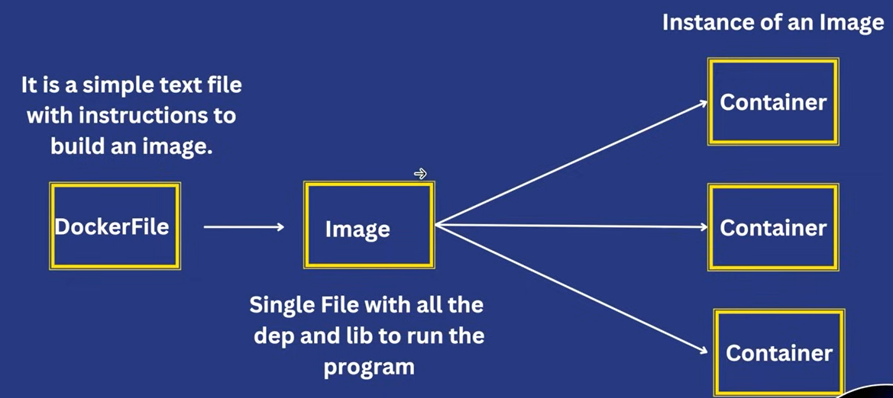

# Docker
Docker is a contenarization platform for developing, packing, shipping, and runing applications.
<br>
It provieds the ability to run an application in isolated environment called containers.
<br>
Make development and deployment efficient.


### Why we need docker
**Problem** : You developed an application, and given it to the tester to test. It was working fine on your machine but throw error / not working on tester machine. There could be several reason such as OS, different versions of libraries/dependencies, external dependenciees. But it was working fine on your machine.

**Solution** : Docker 
<br>
Developer make package of all the neccessary things to run the application (dependencies, services, configuration files, libraries, etc) using docker.


### Container
A way to package an application with all neccessary dependencies and configuration.
<br>
It can be easily shared.
<br>
Makes Deployment and Development efficient.


### Architecture of Docker


#### Use Case 1 : Multiple Apps
Multiple Containers can also be run, in isolated environment. Means app1 don't know any thing about app2.


#### Use Case 2 : Same app of different version
**Approach 1**: Use two different virtual machine
<br>

**Approach 2**: Using Docker


<br>
App1 - using Node(13 version)
<br>
App2 - using Node(14 version)


#### Docker Vs Virtual Machines
| Docker Containers | VMs |
|---|---|
| Low impact on OS, very fast, low disk space usage | High impact on OS, slower, high disk space usage |
| Sharing, re-building and distribution is easy | Sharing, re-building and is challenging |
| Encapsulate apps instead of whole machine | Encapsulate whole machine |


### Flow and Components of Docker



#### Dockerfile
 A Dockerfile is a text file containing instructions that tells the docker how to build a Docker image.


#### Docker Image
A Docker image is a read-only package containing everything needed to create and run a container.


#### Docker Registry
A Docker Registry is a central repository for storing and distributing Docker Images.
<br>
Developer (Dockerfile) -> Image -> Docker Hub OR Private Repository -> Tester


#### Docker Hub
Docker Hub is a cloud-based registry where Docker images are stored, shared, and downloaded.


### Creating Docker File
- First we need the base : in our case its (node.js) `FROM <base>:<baseVersion>(optional)`
- Create Working directory in Container (currently empty container) `WORKDIR /myapp`
- Copy the file to the container WorkDir to use `COPY <Source : File/Folders> <Destination>
- Run the commands `RUN <commands>`
    - RUN commands will be used while creating the image (docker image)
- Expose is used to specify the port need to run the iamge on
- CMD : array of command word, to run the command after the image is start (running)
    - `CMD ["command:part1", "command:part2"]`
```DockerFile
FROM node:20
WORKDIR /myapp
COPY . .
RUN npm install
EXPOSE 3000
CMD ["npm", "run", "dev"]
```

**Create and Docker Image**
<br>
```bash
# Create Image
docker build /path/to/Dockerfile

# Run Image
docker run <Image-ID>
```

**Need to change something to use the vite on local from docker container**
```json
// In package.json
{
    ...,
    "scripts": {
    "dev": "vite --host"
    }
}
```


## Commands
1) Build Image : `docker build /path/to/Dockerfile`
2) Show Images : `docker image ls`
3) Show Running Containers (Process State) : `docker ps`
4) Stop Container : `docker stop <container-name-ps>`
5) Build Image with tag : `docker build -t <tagname> /path/to/Dockerfile`

